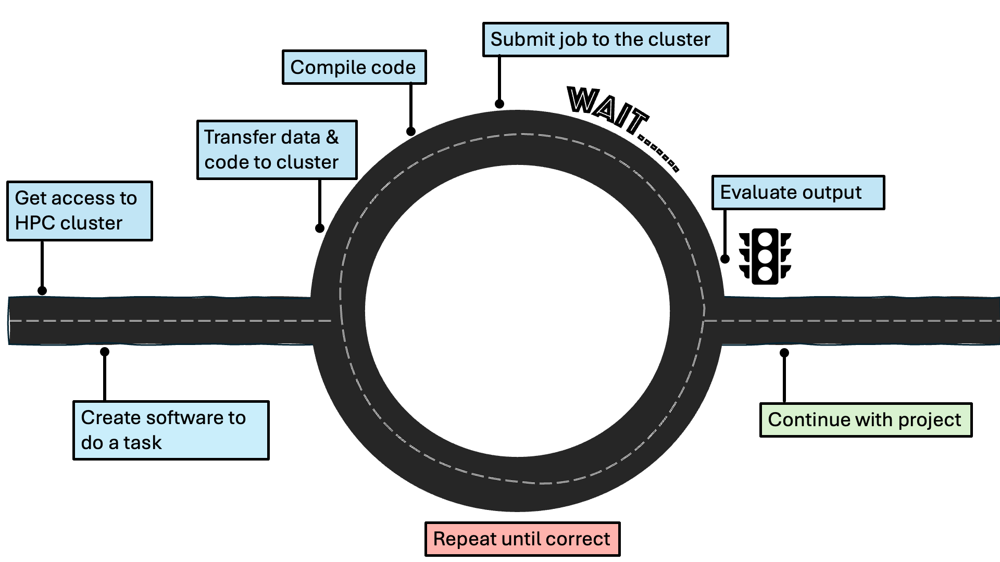

:::::::::::::::::::::::::::::::::::::: questions 

- What are the basic steps of an HPC workflow?
- How do workflows differ for different types of HPC?

::::::::::::::::::::::::::::::::::::::::::::::::

::::::::::::::::::::::::::::::::::::: objectives

- TBA

::::::::::::::::::::::::::::::::::::::::::::::::

## Basic steps
Now that we have a basic understanding of the why and what of HPC, let's have a look at how someone could use an HPC system.

The basic steps are displayed in this diagram:



### Getting access to an HPC cluster

Once a researcher has established that their project would benefit from using HPC, they need to find out what HPC resources are available to them through their institution.
As research facilitators, you are likely one of the people who would help them with this!
Researchers will generally have access to a local HPC facility, managed by their institution, a regional or national one.
At the time of writing (late 2026), the UK national supercomputing service is [ARCHER2](https://www.archer2.ac.uk/), hosted by EPCC.
Examples of regional (Tier-2) HPC facilities in the UK are: [Baskerville](https://www.baskerville.ac.uk/) and [CSD3](https://www.hpc.cam.ac.uk/high-performance-computing).
Support with more explicitly AI projects is provided by [IsembardAI](https://docs.isambard.ac.uk/), hosted by the Bristol Centre for Supercomputing.
A list of HPC facilities in the UK can be found on the [HPC-UK website](https://www.hpc-uk.ac.uk/facilities/) and a list of what access different UK universities have to local and regional HPC facilities can be found on [Zenodo](https://doi.org/10.5281/zenodo.21977720).
Note that this is a changing landscape, which will develop in accordance to the joint DSIT and UKRI  policy paper on the [UK Compute Roadmap](https://www.gov.uk/government/publications/uk-compute-roadmap/uk-compute-roadmap).
Once the researcher has identified a suitable HPC facility, they will need to follow that facility's instructions on gaining access.

### Logging in

HPC clusters are accessed _remotely_, meaning that generally you won't see the cluster that you are connecting to.
Instead, you use your own computer to access the cluster by establishing a _secure connection_.
Interaction with HPC systems typically happens through a command-line interface (CLI), such as the Windows Command Prompt or the macOS Terminal.
It is important that this connection is secure, such that the data, code, or output shared with the HPC cluster cannot be intercepted.
This is usually achieved by using the Secure Shell (SSH) protocol to open an encrypted connection between the two machines.

Let's try logging into our own mini cluster now!
Open the CLI of your choice and type the following:

```bash
ssh [whatever the name ends up being]
```

We are now in the dedicated login node that was mentioned in the previous episode! 

For more information, please refer to the HPC Carpentry episode on [Connecting Securely to an HPC Cluster](https://carpentries-incubator.github.io/hpc-intro/11-connecting.html).

### Transferring files

The login node is basically the entry to the cluster - it is not where we would want to store files and run jobs.
As was mentioned in the previous episode, three of the nodes of our mini cluster act as a dedicated memory system.
That is where we will be storing our files, like data and code.

It is possible to transfer individual files or entire directories to the cluster.
The simplest way to do so is the `scp` command, which stands for "secure copy".

```bash
local$ scp local_file user@cluster.name:remote_destination
```

A more advanced option is `rsync` which allows you to transfer large files more quickly than `scp`.

For more information, please refer to the "Transferring Files with Remote Computers" episode, specifically from the section [Transferring Single Files and Folders with scp](https://carpentries-incubator.github.io/hpc-intro/16-transferring-files.html#transferring-single-files-and-folders-with-scp) onwards.

<!-- would this be a good place to talk about back-ups?-->

### Compiling the code

When humans write code, they use programming languages that are fairly straightforward for them to interpret.
However, computers aren't able to understand this!
Different programming languages take different approaches to how they turn human-readable instructions to machine-readable ones, leading to the distinction between _compiled_ languages and _interpreted_ ones.
In compiled languages (like C, C++ and Fortran), a distinct step is required after the code being written and before it is executed.
During compilation, the human-readable instructions are turned to binary code (1s and 0s) that the computer can read.
Interpreted languages (like Python, R, and MATLAB) are interpreted while they are being run and do not require a separate step.
However, compiled languages are significantly faster to run, which becomes only more important in HPC systems that rely on efficiency.
Thankfully, it is possible to use wrappers around interpreted languages, which allows researchers to write their code in, for example, Python and still run it on an HPC cluster in an efficient manner.

For more information, please refer to the [Building and Running C/C++/Fortran Codes on HPC Systems](https://learning.rc.virginia.edu/notes/building-running-c-cpp-fortran/) lesson.

### Submitting a job to the cluster


#### Schedulers
<!--
[what is SLURM, what are other schedulers]

batch versus interactive
-->


<!--
Call-outs to consider including

- TREs
- data security
- software licencsing (including per-core licensing)
-->

